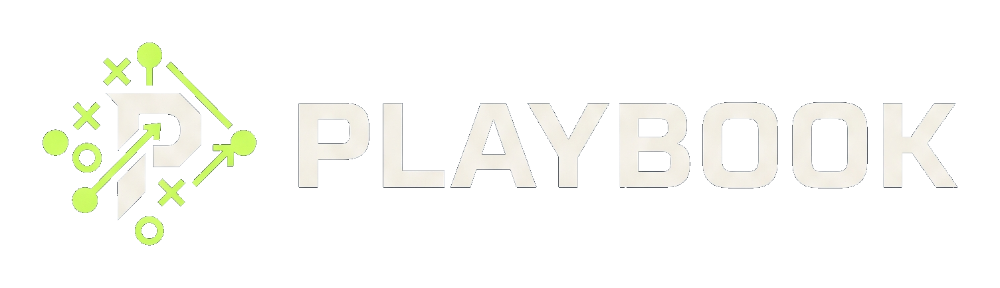
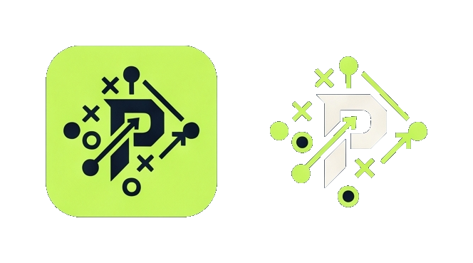
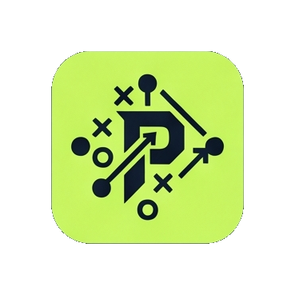

# Playbook visual asset catalog

The original [Logo-Kit.jpeg](Logo-Kit.jpeg) is retained unchanged. It contains five distinct marks in four labelled sections. Six exported regions include the paired small icons and each individual mark.

| Region | Use | Transparent preview |
|---|---|---|
| Primary horizontal lockup | README and website masthead |  |
| Large emblem | Chapter opening and system overview |  |
| Paired icons | Compare tile and freestanding emblem |  |
| Monochrome lockup | Single-colour identity on dark surfaces |  |
| Application tile | Compact app identity with navy ink preserved |  |
| Small emblem | Compact chapter identity |  |

## Four versions per region

- `-source.png`: original JPEG pixels in the selected rectangle, saved losslessly.
- `-transparent.png`: dark sheet background removed, tightly trimmed.
- `-transparent-padded.png`: transparent mark with 64 pixels of transparent canvas on every side. This is transparent whitespace around the artwork.
- `-whitespace-transparent.png`: cream/near-white artwork also knocked out to alpha. This is white-space knockout within the artwork. It changes the mark: use only as a colour accent or overlay. The monochrome variant becomes empty because all of its ink is cream; use its other variants for visible identity.

Use cream wordmarks on dark surfaces for contrast. Keep the tile's navy drawing. These are raster extracts at source resolution, not vector masters. JPEG compression limits exact edge recovery; colour tolerance removes the sheet background.

## Reproduce the set

Run `python3 assets/build-assets.py` with ImageMagick's `convert` installed. [manifest.json](manifest.json) records the source SHA-256, crop coordinates, padding and filenames. Coordinates use the original 1792 × 2400 pixels. The tile uses exterior flood-fill to preserve its navy drawing.

An imagegen transparency pass was inspected during preparation. Its altered edges were unsuitable for the identity marks; shipped exports use original sheet pixels and repeatable segmentation.

The [anthology](../docs/anthology/README.md), root README and website generator consume these canonical assets. Site generation copies them into its output so relative references work.
