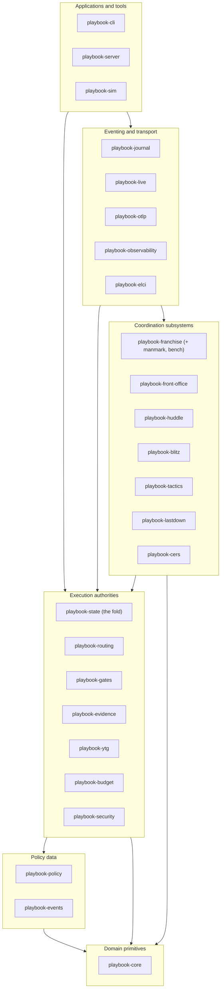

# Playbook System Architecture

## Purpose of this document

This document is the architectural map of the Playbook workspace for engineering leads. It answers four questions: which crates exist and why they are layered the way they are; how the write path (journal, fold, state) produces authority; how the coordination subsystems compose without owning the drive; and where determinism is bought with data versus compiled rules.

The governing model is stated once and assumed everywhere below: Playbook is a deterministic, evidence-governed organisational control plane. A `DriveEvent` journal is the only write path; `playbook-state` folds that journal into `DriveState`; subsystem ledgers (huddles, blitzes, tactics, franchise, CERS) are folds of the same journal under one-to-one event projections. Models and inference may propose progress; only sealed evidence establishes it. Nothing in the workspace calls a model from the state machine.

The workspace is 25 crates under `crates/`, declared in the root `Cargo.toml`, edition 2021, `unsafe_code = "forbid"` applied workspace-wide.

## The layered crate map

Dependencies point strictly downward through five layers. Domain primitives depend on nothing internal. Execution authorities read policy as data. Coordination subsystems observe and propose through events; they never mutate drive state directly. Eventing and transport crates sit at the boundary and are the only crates permitted to perform I/O.

Read the diagram as authority flow, not call flow: `playbook-cli` and `playbook-server` drive the authority through `playbook-state`; `playbook-journal` makes every committed event durable before the authority commits it in memory; subsystem crates contribute event payloads (via `playbook-events`) and fold functions, but the reducer in `playbook-state` owns the commit.

### Crate inventory

Every workspace member, with its responsibility and its notable dependents. "Dependents" lists internal crates that declare the dependency in `Cargo.toml` (dev-dependencies are marked).

| Crate | Responsibility (one line) | Notable dependents |
| --- | --- | --- |
| `playbook-core` | Domain primitives: machine ids, gates, evidence types, task and game contracts, budgets, personnel, canonical serialisation, SHA-256 digesting; no function in this crate calls a model. | Every other crate. |
| `playbook-events` | The immutable `DriveEvent` enum — the single write-path vocabulary, tagged `snake_case` on the wire. | `playbook-state`, `playbook-journal`, `playbook-observability`, `playbook-cli`, `playbook-server` |
| `playbook-policy` | Data-driven tactical policy: thresholds, play definitions, costs, permissions, routing and budget weights, admission envelopes — as a serialisable bundle, not `if` chains. | `playbook-state`, `playbook-routing`, `playbook-journal`, `playbook-sim`, `playbook-cli`, `playbook-server` |
| `playbook-state` | The deterministic reducer: `fold` over `DriveEvent` under `ApplyMode::{Audit, Resimulate}`, `DriveState`, the `Authority` write path, `evaluate_branch`, and the one-to-one subsystem projections. | `playbook-journal`, `playbook-franchise`, `playbook-huddle`, `playbook-blitz`, `playbook-live`, `playbook-sim` (dev), `playbook-cli`, `playbook-server` |
| `playbook-gates` | The deliver-gate graph: gates move only on evidence or an explicit waiver with authority and reason. | `playbook-state`, `playbook-sim` |
| `playbook-evidence` | Scores raw tool output into weighted evidence classes; narrative claims are stored and then ignored by the gate graph. | `playbook-gates`, `playbook-state`, `playbook-sim` |
| `playbook-ytg` | Yards-to-go as weighted, evidence-backed distance across gates, scaled milli-units against a 10,000-yard reference; the derived `ProgressVector`. | `playbook-routing`, `playbook-state`, `playbook-sim` |
| `playbook-budget` | The multidimensional drive budget; the effective remainder is the scarcest weighted dimension, so a healthy token balance cannot hide an empty quota. | `playbook-state`, `playbook-sim` |
| `playbook-security` | Least-privilege side-effect authorisation from the policy allow-list; it has no budget parameter. | `playbook-routing`, `playbook-state`, `playbook-live`, `playbook-sim` |
| `playbook-routing` | Play admissibility and personnel routing: deterministic candidates before specialists, measured priors over self-reports. | `playbook-state`, `playbook-sim` |
| `playbook-huddle` | Budgeted, policy-admitted synchronisation barriers between concurrently operating personnel, with its own `apply_huddle` fold. | `playbook-events`, `playbook-state`, `playbook-sim` |
| `playbook-blitz` | Defensive parallel single-focus inference: frozen targets, independent workers, verification before victory, `apply_blitz` fold, escalation to huddle. | `playbook-events`, `playbook-state`, `playbook-franchise`, `playbook-cers`, `playbook-sim` |
| `playbook-tactics` | The organisational-shape layer: formations, adjustments, diagnostic patterns, conservative doctrines, surveillance, responsibility exchange; a conflict matrix that fails closed. | `playbook-sim` |
| `playbook-franchise` | Durable ownership above drive authorities: objectives, roster acquisition and freezing, the shared salary cap, substitution; hosts the bench decision service and the manmark registry (`franchise::manmark`). | `playbook-server`, `playbook-live`, `playbook-sim` |
| `playbook-front-office` | Offline, deterministic roster portfolio construction from closed-season history; emits the static `ROSTER/1` contract with no execution-plane dependency. | `playbook-franchise`, `playbook-server` |
| `playbook-lastdown` | Fourth-down doctrine: convert, field goal, punt, reset, abandon; seals the `PLAYBOOK/1` continuation package with the amnesia keys omitted. | `playbook-state`, `playbook-sim` |
| `playbook-cers` | Cognitive exhaust recovery: every materially failed play, closed blitz, or provider outage yields one structured, reusable recovery artefact. | `playbook-sim` |
| `playbook-elci` | The `CapabilityPlane` trait — inspect, execute, validate — plus the deterministic `FixturePlane` used by simulation and tests. | `playbook-state`, `playbook-huddle`, `playbook-franchise`, `playbook-server`, `playbook-live` |
| `playbook-journal` | The durable write-ahead store: one checksummed JSON line per event, fsync before commit, longest-valid-prefix recovery with truncation at the first bad record. | `playbook-sim`, `playbook-cli`, `playbook-server` |
| `playbook-live` | The 0.2.x live execution layer: `ExecutionEnvelope`, real `ToolPlane` execution, the `ModelTransport` seam, at-least-once `DispatchLedger`, conservative cancellation, `FaultPlane` fault scripting. | Terminal consumer (leaf). |
| `playbook-observability` | The OpenTelemetry-shaped trace model: one drive is a trace, plays and tool calls are spans; explanations cite measurements, never model reasoning. | `playbook-otlp`, `playbook-cli`, `playbook-server`, `playbook-sim` |
| `playbook-otlp` | OTLP/HTTP+JSON export with a hand-rolled HTTP/1.1 client and SHA-256-derived deterministic span ids; no opentelemetry dependency. | `playbook-cli`, `playbook-server` |
| `playbook-sim` | Deterministic replay, the MVP acceptance drive, policy comparison by resimulating historical logs, Tov normalisers, and the canonical franchise game. | `playbook-state` (dev), `playbook-cli`, `playbook-server`, `playbook-franchise`, `playbook-huddle` |
| `playbook-cli` | The command surface: `mvp`, `recover`, `sim`, `explain`, `status`, `priors`, `sprint`, `otlp`. | Terminal consumer (leaf). |
| `playbook-server` | The continuous HTTP drive service: journals every event before responding, recovers journals on boot, exposes `/v1/franchises`; its contract of record is `docs/server-directive.md`. | Terminal consumer (leaf). |

Two placement notes. First, there is no `playbook-manmark` crate: the manmark registry (`Mark`, `MarkState`, `ManmarkRegistry`, `InspectionTrigger`, `Remediation`, and the strategic-to-instinctive graduation path) lives in `playbook-franchise` as the `manmark` module, with blitz's `ManmarkRequest` as its escalation producer. Second, `playbook-sim` appears as a dependency of `playbook-state` only under `[dev-dependencies]`, for checked-in fixture-equality tests; the production dependency graph stays acyclic.

## The control plane: journal, fold, state

Every state change in Playbook is a `DriveEvent`. The enum in `playbook-events` is closed and versioned: drive lifecycle events (`DriveStarted`, `PlaySelected`, `ToolInvoked`, `ToolSucceeded`, `ToolFailed`, `ToolOutcomeRejected`, `DriveCompleted`, `AbandonIssued`), evidence and gate events (`EvidenceAccepted`, `GateDeclared`, `ArtefactProduced`, `ArtefactValidated`, `ArtefactRejected`, `WaiverGranted`), economics (`BudgetConsumed`, `PriorsLoaded`), field events (`YtgRecalculated`, `DownChanged`, `FourthDownDeclared`, `PuntIssued`, `PossessionStarted`), and subsystem events (`BenchDecision`, `PlayerSubstituted`, `HuddleRequested` through `HuddleClosed`, `BlitzProposed` through `BlitzAborted`, `GameContractSealed`, `EvaluationDecided`, `CersRecovered`, `TacticAdmitted` through `TacticCountered`). Snapshots are caches; the log is the state.

The write path is deliberately narrow:

1. The `Authority` in `playbook-state` receives an intention and constructs exactly one event.
2. If a journal is attached (`Authority::start_journaled`, `Authority::attach_journal`), the event is recorded through the `EventSink` trait and fsynced by `playbook-journal` before the authority commits it to in-memory state. An invocation is therefore recoverable before the capability plane is called.
3. The authority applies the event to `DriveState`. Because `apply` is a pure function of (state, event, policy), any observer can recompute the state with `fold`.

Subsystems do not get their own write paths. Their journal events project one-to-one onto subsystem folds: `playbook-state::apply::project_huddle` maps `Huddle*` events onto `playbook_huddle::HuddleEvent` and `playbook_huddle::apply_huddle` folds them into the huddle ledger; `project_blitz` does the same onto `playbook_blitz::BlitzEvent` and `apply_blitz`. Tactic events (`TacticAdmitted`, `TacticRejected`, `TacticCompleted`, `TacticFailed`, `TacticCountered`) project onto the `TacticRecord` ledger inside the reducer for multi-play tactical memory. The subsystem state machines are therefore views of the same log, not parallel sources of truth: a huddle that never produced journal events never happened.

The fold runs in two modes, and the distinction is operational, not cosmetic. `ApplyMode::Audit` replays a log to reproduce and verify state — it is what `playbook recover` uses after checking digests and sequence numbers and truncating at the first torn, tampered, or out-of-sequence record. `ApplyMode::Resimulate` reclassifies a historical log under a different policy bundle without editing it — it is what `playbook sim --policy` uses for comparison. Both modes must reproduce identical state from identical logs, and the checked-in fixtures in `playbook-huddle` and `playbook-blitz` hold that equality as a test invariant. A tampered witness is a replay divergence by construction, which is what makes the audit meaningful.

## How subsystems compose

The subsystems are roles around one referee. The separation of labour is:

- **The franchise owns.** `playbook-franchise` holds durable objectives, roster membership, availability, and the shared multidimensional salary cap across drives. `playbook-front-office` builds roster portfolios offline from closed-season history and emits `ROSTER/1`; the roster stays staged until an explicit transaction window, freezes at kickoff, and survives punts and recovery. The franchise also hosts the two ownership services added during the Franchise Runtime Closure: the bench decision service (`franchise::bench`), which classifies substitutions into the five deterministic classes, and the manmark registry (`franchise::manmark`), which assigns ownership, severity, and inspection triggers to marked domains.
- **The state classifies.** `playbook-state` is the independent official. `classify_measurement` turns a measurement plus policy into the same down every time; `evaluate_branch` is the single deterministic decision point that names the EVALUATING branch — `ADVANCE`, `HUDDLE`, `SUBSTITUTE`, `LASTDOWN`, `BLITZ`, or `CERS_RECOVERY` — with reason codes, and journals the choice as an `EvaluationDecided` record.
- **Tactics recommends shape.** `playbook-tactics` decides what the organisation looks like while executing: formations, adjustments, diagnostic attack patterns, conservative doctrines, surveillance assignments, responsibility exchanges. It recommends and structures; it never executes and never moves a gate.
- **The coordination authorities execute.** A huddle reconciles divergent team state when admission economics say reconciliation is cheaper than divergence. A blitz races independent workers on a frozen target when delay is more expensive than redundancy, and escalates to a huddle only on a failed independence attempt. Lastdown disposes of fourth down: convert, field goal, punt (sealing the continuation package), reset, or abandon. CERS harvests the residue of failed work into structured artefacts so the next drive does not repeat a failure blind. The bench substitutes; manmark resolves marked domains without inference until graduation.

The seam that keeps this composition safe is **recommend versus execute**. Subsystems compute proposals — a `HuddleRecommendation`, a `BlitzProposed`, a tactic admission, a bench class — but only the fold commits outcomes, and it commits them only when policy admits the proposal and the budget and security authorities agree. Inference recommends, never decides: that boundary is stated in the closure campaign and enforced structurally, because the only code that can mutate `DriveState` is `apply` in `playbook-state`, and the only input it accepts is a journalled event.

## The 0.2.x live execution layer

Through 0.1.x, every capability invocation ran against `FixturePlane`. `playbook-live` is the beginning of real operation, built as a set of rules with constitutional standing rather than a driver:

- **`ExecutionEnvelope`** — every live invocation receives a complete envelope; the executor never supplies a missing field itself. Inferred authority is not authority.
- **`ToolPlane`** — real command execution for tool personnel under enforced deadlines with sealed outcomes, replacing the fixture at the `CapabilityPlane` seam.
- **`ModelTransport`** — the provider seam for model personnel. A model response is packaged as a claim artefact for downstream verification and can never satisfy a gate by itself; the default transport deliberately refuses to operate, so a host must supply one explicitly.
- **`DispatchLedger`** — at-least-once dispatch with explicit reconciliation. The stages are fixed: invocation persisted, dispatch attempted, effect occurrence unknown, effect reconciled, outcome accepted or rejected. No retry happens merely because the caller did not receive a response.
- **Cost honesty** — an invocation whose spend cannot be measured reports `CostReport::unknown`; the authority reserves capacity for it and never books it as free.
- **Conservative cancellation** — cancellation is a six-state answer; an unknown cancellation state is an unknown effect, reconciled, never optimistically booked.
- **`LiveIdentity`** — stable empirical identity: a change of provider, model, profile, or tool envelope yields a distinct personnel record, because comparability across such a change would be a lie.
- **`FaultPlane`** — the directive's full fault list is scripted against any plane, so the same fault injections that prove the fixture also exercise a live host.

`playbook-live` consumes `playbook-core`, `playbook-elci`, and `playbook-security` (with `playbook-franchise`, `playbook-policy`, and `playbook-state` as dev-dependencies for its live-runtime gate tests), and nothing in the production graph consumes it yet — it is the newest layer of the onion, and the fixture remains what the tests and the server drive by default.

## Deterministic boundaries

The workspace maintains a strict line between what is compiled and what is configured:

**Data-driven.** `playbook-policy` owns thresholds, play definitions, costs, permissions, routing weights, budget weights, huddle and blitz envelopes, and the prior-sample threshold that switches routing from self-report to measured record. Because these are data, a policy bundle can be swapped, diffed, versioned under `fixtures/`, and checked against schema. Policy comparison exploits this directly: `playbook sim` reclassifies a recorded trace under `builtin` or `playbook-policy-pass-heavy` and reports how the classification changes, without generating counterfactual actions and without editing the log. The Tov normalisers in `playbook-sim` apply replaceable, versioned-as-source scoring adapters on the same terms: a missing or failing module degrades scoring, never the fold.

**Compiled.** The fold rules are code: the reducer's event applications, the gate graph's evidence-only movement, the yards-to-go weighting formula, the scarcest-dimension budget rule, the side-effect authorisation check, huddle admission economics, the blitz race state machine, the tactics conflict matrix, and Lastdown's utility order. Changing any of these changes what replay means, so each change is guarded by fixture-equality tests that fold checked-in journals under both `Audit` and `Resimulate` and require identical state. The compiled side is where the invariants live — evidence-free claims leave yards-to-go unchanged; budget does not grow inside a possession; a mandatory failed gate cannot complete the drive; replay reproduces the state — and the data side is where operators are free to move.

The practical rule for reviewers: a pull request that changes behaviour without a policy diff is a change to the constitution and needs replay evidence; a pull request that only changes the policy bundle is a change of doctrine and needs only the bundle checks.

## Cross-references

- `docs/franchise.md` — the franchise contract: API, budget semantics, operating limits.
- `docs/front-office.md` — restricted inputs, scoring, and API of offline roster construction.
- `docs/huddles.md` — huddle journal events, admission economics, and the state machine.
- `docs/blitz.md` — blitz journal events, eligibility, envelopes, and the race state machine.
- `docs/tactics.md` — the tactics contract, admission economics, and the conflict matrix.
- `docs/live-runtime.md` — the live runtime contract: journal events, envelopes, identity, the fault table.
- `docs/server-directive.md` — the contract of record for `playbook-server`.
- `docs/closure-campaign.md` — the Franchise Runtime Closure gap analysis and release-gate record that produced the bench, manmark, CERS, and evaluation-branch subsystems.
- `README.md` — delivery status, run commands, and the invariants the tests hold.
