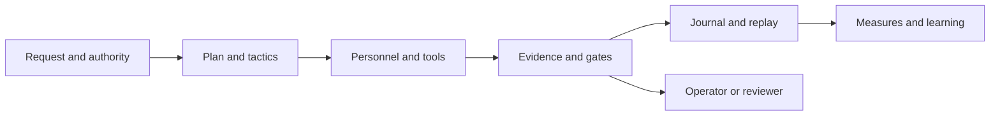
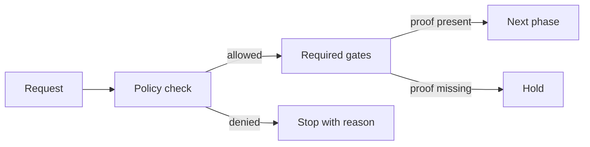
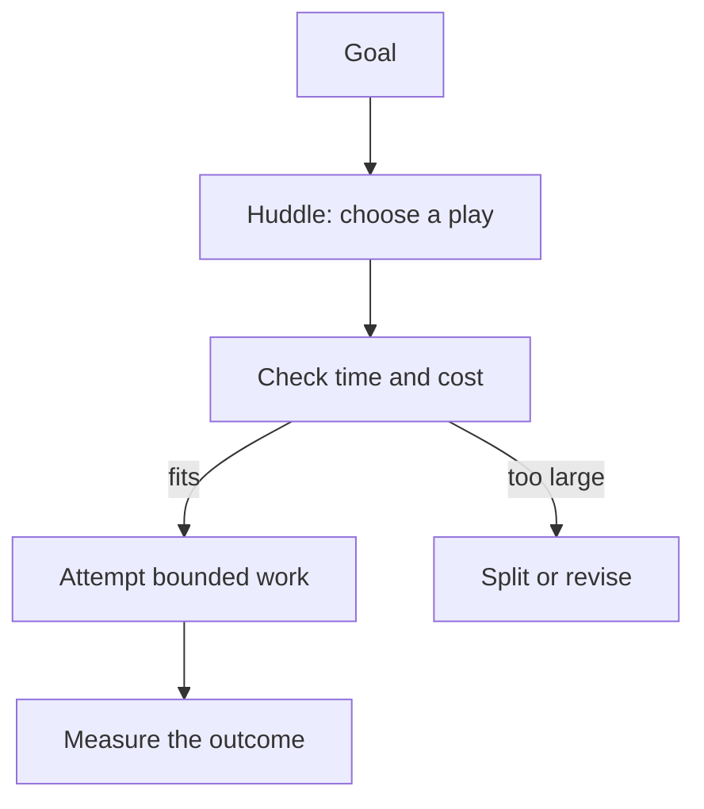
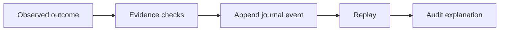
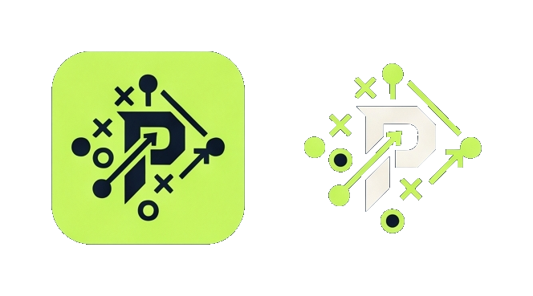

# Module Playbook: How the Parts Work Together

This guide is for readers who want to follow the code without already knowing its vocabulary. Each section uses the same play: **job**, **inputs**, **decision**, **result**, and **when it fails**. Crate names below refer to folders in `crates/`. The contract pages listed in each section define the exact rules; this guide teaches the map.

## The whole drive, in one picture

A useful mental model is a sports playbook. A coach proposes a play, but the rules decide whether it is allowed. The team performs work, the scorekeeper records what happened, and the film room checks the record afterward. In Playbook, models and tools may suggest or perform bounded work; evidence and policy determine what counts.

## 1. The field and the rules

**Crates:** `playbook-core`, `playbook-field`, `playbook-policy`, `playbook-ytg`, `playbook-gates`.

- **Job:** define the shared vocabulary, the playing field, the current rules, distance-to-go, and the gates that must be passed.
- **Inputs:** a request, current state, policy, and evidence already accepted.
- **Decision:** is this action in bounds, and what must be true before it can proceed?
- **Result:** a typed decision or a clear stop reason.
- **When it fails:** missing or conflicting proof blocks progress; a proposal alone does not count as completed work.

**Study next:** [field geometry](../field-geometry.md), [tactics](../tactics.md), [closure campaign](../closure-campaign.md).

## 2. People, teams, and authority

**Crates:** `playbook-franchise`, `playbook-front-office`, `playbook-routing`, `capability-plane`, `playbook-security`.

- **Job:** describe who is on the roster, what each role can do, and where work may be routed.
- **Inputs:** organisation setup, personnel capabilities, requested task, and granted authority.
- **Decision:** choose an eligible role and route while respecting the scope of its access.
- **Result:** an assignment with explicit boundaries.
- **When it fails:** no eligible role means no assignment; a role cannot gain authority just because a task asks for it.

Think of a capability as a player’s position and permitted equipment. A routing rule picks a suitable player; it does not rewrite the rulebook.

**Study next:** [franchise](../franchise.md), [front office](../front-office.md), [security and boundaries](05-security-and-boundaries.md).

## 3. Planning the work

**Crates:** `playbook-huddle`, `playbook-tactics`, `playbook-budget`, `playbook-blitz`.

- **Job:** turn a goal into bounded steps, account for cost, and support focused improvement work.
- **Inputs:** goal, current position, available budget, and applicable policy.
- **Decision:** which next step is worth attempting, and what evidence will show it worked?
- **Result:** a plan or a measured comparison, not proof that execution happened.
- **When it fails:** a plan that exceeds its limits is rejected or narrowed; a hypothetical result remains hypothetical.

**Study next:** [huddles](../huddles.md), [blitz](../blitz.md), [value](../value.md).

## 4. Doing work and handling uncertainty

**Crates:** `playbook-live`, `playbook-integration`, `playbook-lastdown`, `playbook-resolution`.

- **Job:** connect plans to runtime personnel and external systems, then resolve what happened.
- **Inputs:** an approved invocation, adapter configuration, and limits.
- **Decision:** dispatch only within the authorised boundary and classify the returned outcome.
- **Result:** success, a known failure, or an uncertain outcome that needs reconciliation.
- **When it fails:** a timeout does not prove that the outside action did not happen. Operators must check before retrying actions with side effects.

**Study next:** [live runtime](../live-runtime.md), [integrations](../integrations.md), [operations runbook](04-operations-runbook.md).

## 5. Evidence, journal, and replay

**Crates:** `playbook-evidence`, `playbook-events`, `playbook-journal`, `playbook-integrity`, `playbook-cers`.

- **Job:** record claims and events so reviewers can reconstruct a run.
- **Inputs:** observed outcomes, evidence references, and event ordering.
- **Decision:** whether the evidence is admissible and internally consistent.
- **Result:** an auditable journal that can be inspected or replayed.
- **When it fails:** a journal can explain recorded events, but cannot make an unrecorded external side effect disappear or prove that a host persisted it.

**Study next:** [evidence, journal, and replay](03-evidence-journal-replay.md), [journal recovery](../live-runtime.md).

## 6. Interfaces, reports, and measures

**Crates:** `playbook-cli`, `playbook-server`, `playbook-presentation`, `playbook-tui`, `playbook-cards`, `playbook-observability`, `playbook-otlp`, `value-lab`.

- **Job:** let people operate the system and inspect its state through command-line, server, terminal, cards, and telemetry views.
- **Inputs:** state, events, and the view or export requested.
- **Decision:** format and expose information without changing the underlying authority rules.
- **Result:** a status, explanation, replay, visual card, or exported trace.
- **When it fails:** a display is a view of the record, not a substitute for the record or its evidence.

**Study next:** [command surface](../command-surface.md), [matchday](../matchday.md), [metrics and quality gates](06-metrics-and-quality-gates.md).

## 7. Build, release, and governance

**Crates:** `playbook-ci`, `ci-evidence`, `ci-governance`, `ci-authorities`, `claims`, `dev-foreman`, `site-foreman`.

- **Job:** decide whether a change has the required evidence and authority to move through its release path.
- **Inputs:** source changes, declared claims, checks, and approvals.
- **Decision:** whether the required gates are satisfied.
- **Result:** a reviewable release decision and supporting evidence.
- **When it fails:** a green local display without the required evidence does not satisfy a gate.

**Study next:** [CI](../ci.md), [security and boundaries](05-security-and-boundaries.md), [operations](04-operations-runbook.md).

## A reader’s route through the repository

1. Start with this map and the [executive overview](00-executive-overview.md).
2. Read the contract page for the area you are changing.
3. Follow its crate links into `crates/<name>/src/` and compare code with the contract.
4. Read [evidence and replay](03-evidence-journal-replay.md) before interpreting a claim about success.
5. Use the [glossary and event index](07-glossary-and-event-index.md) when a term or event name is unfamiliar.

## Asset variants

The source sheet is [`assets/Logo-Kit.jpeg`](../../assets/Logo-Kit.jpeg). Crops in [`assets/segmented/`](../../assets/segmented/) are PNGs with alpha transparency. Each region has a source crop, tight transparency, padded transparency, and a cream/white knockout. See the [asset catalog](../../assets/README.md) for usage. The latter is useful where layout needs breathing room without baking in a background colour. The source JPEG is retained as the reference; transparency is an extracted approximation because JPEG does not preserve alpha.
