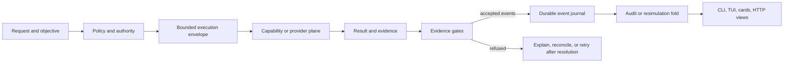
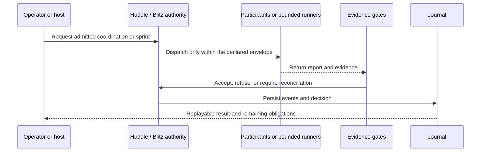

# Feature Walkthroughs: From Request to Review


This chapter is a practical tour of Playbook for someone opening the repository
for the first time. It follows the shipped surfaces: the `playbook` CLI, the
Matchday terminal viewer, durable server routes, generated cards, CI evidence,
and integration seams. Commands below are grounded in `crates/playbook-cli`,
`crates/playbook-tui`, and the server crate. A command's success means that
surface completed its job; it does not automatically mean an external task was
performed or independently validated.

## A map of the system

Playbook separates decision authority, execution, evidence, durable events,
and views. Follow an outcome from its admitted operation to the evidence and
journal before relying on a summary.



**Vocabulary.** A *drive* is a sequence of governed work. A *play* is one
bounded operation; *down* and *yards-to-go* describe measured progress.
These labels organize state and presentation. They never substitute for
authority checks, evidence, or recorded events.

## First five minutes

Run these from a checkout with the workspace binaries available:

```sh
playbook --help
playbook status
playbook policy
playbook mvp --journal /tmp/playbook-tour.jsonl
playbook explain
playbook recover /tmp/playbook-tour.jsonl
```

`--help` describes the accepted forms. `status` and `policy` are read-only
views. `mvp` runs the deterministic acceptance drive; the journal path is an
explicit output file. `explain` describes the built-in acceptance drive, not
an arbitrary live server drive. `recover` opens and folds the journal, so use
the same path you wrote. A missing or empty journal is an error; do not read a
failed recovery as an empty successful drive.

For pipes, `--basic` emits plain values and `--form3` emits 3form events:

```sh
playbook status --basic
playbook mvp --form3
```

The styles are mutually exclusive. Default output may use terminal styling;
color is removed when piped or when `NO_COLOR` is set. Machine consumers
should select a style explicitly and check the command's exit status.

## Acceptance drive: run, retain, inspect

Use the acceptance drive to inspect the standard path through policy,
capability discovery, evidence gates, failure handling, fourth-down
disposition, and independent replay.

```sh
playbook mvp --journal /tmp/tour-drive.jsonl
playbook status
playbook explain
playbook recover /tmp/tour-drive.jsonl
playbook-tui --replay /tmp/tour-drive.jsonl
```

Read `replay clean` as agreement between the live result and the replay fold;
with a journal, also check `journal replay clean`. `disposition punt` is the
acceptance scenario's bounded fourth-down outcome, not a recommendation for a
different production drive. Counters such as false completion claims are
useful precisely because a refused claim remains visible. The journal is the
durable record; the human-readable headline is a projection of it.

If the journal path cannot be created or written, `mvp` reports an I/O error.
If recovery reports a repaired tail, inspect the surviving prefix and
reconcile any external effects before retrying. Recovery does not undo an
external action and does not prove that an unrecorded action never happened.

## Policy and replay comparison

Compare the built-in policy with the supported contrast policy on the same
recorded MVP trace:

```sh
playbook policy
playbook policy pass-heavy
playbook sim --policy pass-heavy --trace mvp
playbook sim --policy builtin --trace /tmp/events.json
```

The CLI recognizes `builtin`/`playbook-policy-1` and `pass-heavy`/
`playbook-policy-pass-heavy`. `--trace mvp` selects the acceptance fixture;
otherwise `--trace` must name a readable JSON event list. Compare the replay
checks (`ytg`, `budget`, and `completion`) before interpreting the economics.
Labels and measurements can differ by policy. This is a reclassification of
recorded events under a policy, not a second execution of the work. Unknown
policy names, unreadable trace paths, and malformed JSON fail with an error.

`playbook priors` shows measured prior data; it is not self-reported agent
quality. `playbook sprint` prints the built-in blitz campaign transcript as a
report. `playbook huddle-study` compares fixed scenarios under coordination
regimes. Those report commands do not dispatch live workers.

## Huddles and Blitz

A huddle collects participant reports under admission rules and records a
decision; it is a coordination step, not evidence that the chosen work has
been completed. The CLI's `huddle-study` is a deterministic comparative
programme. In a hosted drive, huddle request, report, collection, and commit
routes are scoped to that drive and their events use the durable journal.

Blitz is a bounded improvement campaign with admission, budget, race,
verification, and escalation logic. `playbook sprint` presents its canned
acceptance report. It is distinct from a host wiring a real executor to a
bounded capability plane. Read [Huddles](../huddles.md) and [Blitz](../blitz.md)
for each subsystem's state and admission conditions.



## Journals, recovery, and failure handling

The journal is an ordered event record. The recovery command folds valid
events and reports the resulting status, event count, budget, and any repaired
tail:

```sh
playbook recover /tmp/tour-drive.jsonl
```

It refuses a missing or empty journal. A torn or invalid tail is not silently
treated as valid work: recovery preserves the provable prefix and reports the
repair. For live execution, an uncertain provider response is an
`EffectUnknown`; do not retry until reconciliation determines whether the
effect occurred. A timeout or cancellation may leave partial effects and
reserved cost. See [Evidence, Journal, and Replay](03-evidence-journal-replay.md)
and [Live Runtime](../live-runtime.md).

## Matchday TUI: inspect a journal

The TUI projects authoritative state; it does not authorize work or mutate
the drive. Start with a journal produced above:

```sh
playbook-tui --replay /tmp/tour-drive.jsonl
playbook-tui --replay /tmp/tour-drive.jsonl --frame 42
playbook-tui --replay /tmp/tour-drive.jsonl --form broadcast
playbook-tui --live /tmp/tour-drive.jsonl --interval-ms 500
```

Replay walks the event prefix frame by frame; `--frame` selects a frame,
`--form` chooses a presentation form, and `--live` follows appended journal
content. With interactive replay, `n`/`ENTER` advances, `p` goes back, `f`
cycles depth, and `q` exits. If the file is absent, malformed, or has no
events, inspect the path and journal before drawing conclusions. See
[Matchday](../matchday.md) for the projection contract and available forms.

## Play cards: generated view, not policy input

The CLI renders the gallery from the card specifications in
`playbook-cards`:

```sh
playbook cards --basic
playbook cards --threeform
playbook cards --out /tmp/playbook-cards
```

The first prints card names, the second emits card events, and the third
writes `playbook.html` to the requested directory. Without `--out`, plain
mode writes the HTML gallery to stdout. `--out` creates the directory and
overwrites that output file, so choose a disposable or intended destination.
An unrecognized argument or unwritable path is an error. The cards visualize
the same play vocabulary; they do not modify policy or state.

## Hosted drives and the server boundary

`playbook-server` is a long-lived host, separate from the one-shot CLI. Its
HTTP service owns drive instances, persists committed events before returning
responses, and reloads journals on boot. Inspect the executable's current
help/source before starting it; the server configuration and routes are
implemented in `crates/playbook-server`, while
[Server Directive](../server-directive.md) describes the intended contract.
Example route families include:

```text
POST /v1/drives                 create a drive
GET  /v1/drives/{id}             read its snapshot
POST /v1/drives/{id}/steps       request one step
GET  /v1/drives/{id}/events     inspect its events
GET  /v1/drives/{id}/trace      inspect trace data
POST /v1/drives/{id}/huddles/request
```

Consult route handlers and request types for exact JSON bodies; a route name
alone is not an API schema. The host's durable journal is authoritative, not
its in-memory cache. On restart, an open invocation may require reconciliation
before the drive advances. Legacy routes and huddle-ledger routes have
separate responsibilities, as specified by the server contract.

Live execution is deliberately bounded: an execution envelope names identity,
allowed operations and side effects, expected result/evidence classes, budget,
timeout, and a working directory when repository-bound. The live tool plane
refuses commands outside its allowlist. Provider responses are claims until
the required evidence is independently sealed and accepted. Unknown cost is
reserved rather than recorded as zero. A host must reconcile uncertain side
effects before retrying; Playbook does not promise distributed exactly-once
execution.

```mermaid
stateDiagram-v2
  [*] --> Persisted
  Persisted --> DispatchAttempted
  DispatchAttempted --> Accepted: evidence accepted
  DispatchAttempted --> Rejected: evidence or operation refused
  DispatchAttempted --> EffectUnknown: response lost / ambiguous outcome
  EffectUnknown --> ReconciledNoEffect: proven absent; same idempotency key
  EffectUnknown --> ReconciledOccurred: effect confirmed; do not repeat
  ReconciledNoEffect --> DispatchAttempted
  Accepted --> [*]
  Rejected --> [*]
  ReconciledOccurred --> [*]
```



## Observability integration

`playbook otlp <endpoint>` exports the acceptance drive trace to an
OTLP/HTTP collector. `otlp-bench` measures encoding/export throughput and
does not establish collector health or production capacity by itself:

```sh
playbook otlp http://127.0.0.1:4318/v1/traces
playbook otlp-bench --spans 100 --runs 3 --endpoint http://127.0.0.1:4318/v1/traces
```

The collector must be reachable and accept the request; transport/status
failures are surfaced. Use your collector's own telemetry to confirm receipt.
The exporter is an integration seam, not a durable journal or authority.
See [Integrations](../integrations.md).

## Governance, CI, and value claims

Authority and governance define who can admit an operation, which evidence
classes satisfy it, and what budget and side effects are allowed. The
Front Office is an offline planning layer; it cannot grant runtime authority.
Start with [Authority and Governance](02-authority-and-governance.md), then
read [Security and Boundaries](05-security-and-boundaries.md) before enabling
a real capability plane.

The CI federation records revision-bound gate evidence and derives admission
mechanically. The documented `playbook-ci freeze`, `run`, and `verify` flow
must use evidence for the same commit; `ERROR`, `INCONCLUSIVE`, and a skipped
mandatory gate are not passes. Some specialist integrations remain explicitly
pending or placeholders (including the claim audit and full dependency audit),
so a described gate must not be reported as fully implemented beyond its
status in [CI Contract](../ci.md).

Value claims have a separate evaluator. `value-lab` freezes task conditions,
decision snapshots, regimes, thresholds, and fault schedules before scoring;
Playbook's own output is not its own independent proof of superiority. The
miniature/synthetic season is not a substitute for a multi-stratum measured
result. Use [Project Value](../value.md) to distinguish mechanics tests,
conditional evidence, and a proven value verdict.

## A worked reading exercise

Suppose an executor reports “done” but the required test evidence is absent.
Trace the result in this order:

1. Was the request admitted by policy and authority?
2. Did the envelope constrain the actual operation, budget, and side effects?
3. Did the capability/provider plane return the expected evidence class?
4. Did the gate accept that evidence and append the corresponding event?
5. Does audit replay reconstruct the same state?

If a check fails, the narrative remains a claim. If the result is ambiguous,
reconcile the effect before retrying. A green UI, card, report, or CI summary
cannot override missing evidence or a replay mismatch.

## Further study

- [Executive Overview](00-executive-overview.md) — system purpose and scope.
- [Architecture](01-system-architecture.md) — crates and authority flow.
- [Operations Runbook](04-operations-runbook.md) — operating responsibilities.
- [Glossary and Event Index](07-glossary-and-event-index.md) — domain terms.
- [Command Surface](../command-surface.md) — CLI outputs and exact behaviors.
