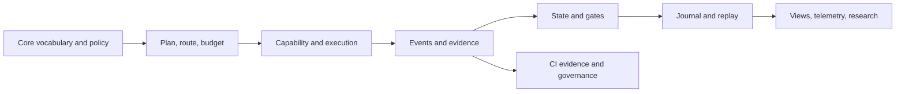

# Crate Atlas: the workspace, crate by crate

This is the source-level field guide to every member listed in the workspace
manifest. Each entry says what job a crate owns, what it takes in and returns,
where its central behavior lives, and what boundary matters when using it.
The descriptions follow the crate docs and current module layout; contract
documents remain the authority where they define stricter rules.

## Read the system as a drive

An ordinary example runs through the layers like this: a requested task is
represented with core types, policy and routing constrain a proposed action,
an execution plane performs bounded work, and observed results become events
and evidence. The reducer updates state only from those events; gates and
distance-to-go reflect accepted evidence. A journal makes the sequence
recoverable, while renderers and reports project it for people. A timeout or
pretty display does not itself prove that an external action failed or that a
gate passed.

## Domain, rules, and progress

### `playbook-core` — shared vocabulary

**Job and flow.** Owns identifiers, domain data, units, deployment metadata,
canonical serialization helpers, priors, and shared contracts. Inputs are
typed values assembled by the rest of the workspace; outputs are stable
domain primitives and errors. The `ids`, `domain`, `units`, `canonical`,
`contract`, `deployment`, `priors`, and `error` modules are the map. A drive
or play should use these shared identifiers rather than inventing a local
spelling. It has no model-calling behavior. See [lib.rs](../../crates/playbook-core/src/lib.rs)
and [domain.rs](../../crates/playbook-core/src/domain.rs). Invalid or
non-canonical values must be rejected at boundaries, not silently normalized
into a different identity.

### `playbook-policy` — data-driven rules

Policy bundles provide thresholds, permitted plays, costs, and permissions to
the state and planning layers. The crate deliberately keeps strategy in data,
so a rule change can be reviewed as a policy change rather than hidden in
branch logic. Start at [lib.rs](../../crates/playbook-policy/src/lib.rs).
For example, a tactical proposal can be compared with the loaded bundle; the
proposal cannot make itself admissible. Missing or incompatible policy means
there is no safe basis for deciding.

### `playbook-security` — side-effect authorization

Authorization combines the configured allow-list with the requested action
class and returns a bounded allow/deny result. It intentionally has no budget
input: spare tokens cannot buy permission to perform a forbidden action.
See [lib.rs](../../crates/playbook-security/src/lib.rs) and
[security boundaries](05-security-and-boundaries.md). A denied class stays
denied even when the drive is urgent.

### `playbook-gates` — deliver-gate graph

Models a set of required conditions and their dependencies. Proposals can
describe gates, but accepted evidence or an explicit waiver is what advances
them. See [lib.rs](../../crates/playbook-gates/src/lib.rs) and
[closure campaign](../closure-campaign.md). A missing predecessor keeps a
dependent gate blocked; prose that says “done” is not a substitute.

### `playbook-evidence` — turn observations into evidence

Consumes raw tool output and evidence context, then produces scored evidence
for downstream evaluation. Narrative claims are retained as data but ignored
by the gate graph. See [lib.rs](../../crates/playbook-evidence/src/lib.rs)
and [evidence and replay](03-evidence-journal-replay.md). Example: attach a
test result to the relevant gate; a claim in a model response without the
supporting observation cannot move that gate.

### `playbook-ytg` — unresolved task distance

Computes weighted remaining distance, `Σ wᵢ(1 − sᵢ)`, on Lastdown’s 10.000
yard reference. Inputs are weighted gate progress scores; output is a
comparable unresolved-work measure. Progress changes only on gate evidence or
an explicit waiver. See [lib.rs](../../crates/playbook-ytg/src/lib.rs).
An unvalidated partial result may be useful but cannot be counted as a
completed yard.

### `playbook-budget` — multidimensional resource limits

Keeps raw resource dimensions visible and derives effective fraction from the
scarcest weighted dimension. This prevents healthy token balance from hiding
an exhausted quota. See [lib.rs](../../crates/playbook-budget/src/lib.rs).
A plan that fits tokens but exceeds time or provider quota must still be
reduced or stopped.

### `playbook-field` — completion economics and field position

Derives deterministic completion geometry from the explicit gate graph:
validated frontier, unvalidated progress, tenth-yard boundaries, causal
adjustments, red-zone status, and terminal-action economics. `geometry` and
`state` carry the geometry; `routing`, `fieldgoal`, `kicker`, `penalties`,
`redzone`, `shadow`, and `domain` cover the related choices. See
[lib.rs](../../crates/playbook-field/src/lib.rs) and
[field geometry contract](../field-geometry.md). Example: a drive near its
terminal boundary can compare a field-goal attempt with another play using
measured field state. Geometry never overrides the gate graph or manufactures
evidence.

### `playbook-state` — deterministic reducer

Applies immutable events and policy to derive the current drive state.
`apply`, `classify`, `evaluate`, and `authority` separate transition,
classification, evaluation, and authority checks. See
[lib.rs](../../crates/playbook-state/src/lib.rs),
[apply.rs](../../crates/playbook-state/src/apply.rs), and
[state contract tests](../../crates/playbook-state/tests/contract.rs).
Replaying the same log under the same policy reproduces the state. A state
snapshot is a derived view, not a replacement for its event history.

## People, planning, and action

### `playbook-franchise` — durable organisation

Owns objectives, roster, and allocations above disposable execution
resources. `bench` and `manmark` implement lifecycle and personnel tracking.
See [lib.rs](../../crates/playbook-franchise/src/lib.rs) and
[franchise contract](../franchise.md). An allocation expresses organisational
intent; Playbook’s evidence authority remains independent when judging work.

### `playbook-front-office` — offline portfolio construction

Builds a deterministic portfolio from closed seasons and deliberately lossy
workload classes. Its interface excludes repositories, live tasks, drive
state, tool handles, and execution callbacks. See
[lib.rs](../../crates/playbook-front-office/src/lib.rs) and
[front-office contract](../front-office.md). Example: compare staffing
allocations for a historical workload. It cannot dispatch the selected
personnel or make a live claim about a repository.

### `playbook-routing` — admissibility and personnel selection

Receives candidate plays, applicable policy, and personnel capabilities; it
filters inadmissible actions and deterministically considers qualified
personnel before specialists. See [lib.rs](../../crates/playbook-routing/src/lib.rs)
and [personnel and organisation](08-personnel-and-organisation.md). Price
alone and model intelligence alone do not win routing. No eligible permitted
route means stop or escalate.

### `playbook-huddle` — synchronization barrier

Coordinates personnel when expected divergence cost justifies the
reconciliation cost. Modules divide trigger, admission, participants,
budget, reconciliation, application, domain, and escalation. Inputs include
scope, participant state, policy, and budget; the result is a bounded shared
understanding or a recorded inability to reconcile. See
[lib.rs](../../crates/playbook-huddle/src/lib.rs) and
[huddles contract](../huddles.md). It should not become a standing meeting:
when reconciliation is unaffordable or out of scope, escalation is explicit.

### `playbook-tactics` — organisational shape of a play

Structures information, interaction constraints, sequencing, formation,
protection, exchange, diagnostics, surveillance, and conservative options
for personnel. It recommends and structures; other authorities execute and
validate. See [lib.rs](../../crates/playbook-tactics/src/lib.rs) and
[tactics contract](../tactics.md). Example: produce a restricted diagnostic
sequence before asking a specialist to act. A tactic cannot grant the
capability it recommends.

### `playbook-blitz` — defensive parallel inference

When delay costs more than bounded redundant inference, freezes a target,
dispatches independent workers, races candidate artifacts through
deterministic verification, accepts the first verified winner, and cancels
redundant work when it no longer adds value. `trigger`, `economics`,
`admission`, `roster`, `budget`, `race`, `verify`, `apply`, and `escalation`
name the stages. See [lib.rs](../../crates/playbook-blitz/src/lib.rs) and
[blitz contract](../blitz.md). A fast candidate that fails verification is
not a win; exhaustion or an unavailable worker is surfaced rather than
treated as success.

### `playbook-lastdown` — fourth-down choice and continuation

Applies measured field state to the utility ordering for Convert, Punt, and
Abandon; converts below `min_attempt` are disqualified. Continuation data
omits model identity, self-assessed confidence, model YTG, and competitive
rankings. See [lib.rs](../../crates/playbook-lastdown/src/lib.rs).
Abandon covers invalid, unsafe, or hopeless drives. Example: choose a punt
when a convert is below threshold even if the model recommends continuing.

### `playbook-live` — real dispatch lifecycle

Connects explicit execution envelopes, personnel identity, providers, tool
planes, dispatch, cancellation, and injected faults. Inputs are a complete
authorized envelope and real capability plane; outputs record dispatch and
reconciliation outcomes with at-least-once semantics. See
[lib.rs](../../crates/playbook-live/src/lib.rs),
[dispatch.rs](../../crates/playbook-live/src/dispatch.rs), and
[live-runtime contract](../live-runtime.md). If cancellation arrives after
dispatch starts, execution is uncertain, not “definitely did not happen”;
reconcile before retrying a side effect.

### `capability-plane` — provider bridge

Forwards an execution envelope to a real model provider and returns a
`ReconciledOutcome` with provider metadata and a structured refusal
observation. The plane observes; it does not judge, so gate failures remain
empty and classification belongs to the Refusal Resolution Plane. The
`openrouter` module is the provider adapter. See
[lib.rs](../../crates/capability-plane/src/lib.rs) and
[openrouter.rs](../../crates/capability-plane/src/openrouter.rs). A possibly
in-flight cancellation sets outcome uncertainty; downstream policy must
classify it rather than infer failure.

### `playbook-elci` — capability inventory for the resolution plane

Defines the capability-plane interface used to inspect, execute, and validate
available tools; `FixturePlane` supplies deterministic behavior for
simulation and tests. See [lib.rs](../../crates/playbook-elci/src/lib.rs).
The down classifier asks the plane what exists instead of carrying a
hard-coded tool list. A fixture is not proof of live provider availability.

### `work-adaptation` — change execution conditions during repair

Pure transformations support the RRP: `brief` clarifies requests,
`decompose` creates deterministic subcontracts, `envelope` controls bounded
execution, and `assembly` composes the result. Inputs and outputs are data;
there is no I/O or state mutation. See
[lib.rs](../../crates/work-adaptation/src/lib.rs) and its
[envelope](../../crates/work-adaptation/src/envelope.rs) and
[decomposition](../../crates/work-adaptation/src/decompose.rs) modules.
Repair may improve clarity or split work, but must not lower the completion
standard.

### `playbook-resolution` — refusal classification and repair policy

The Refusal Resolution Plane (RRP) classifies structured refusal data,
consults authorized repair policy, tracks anchors, lineage, ownership, and
events, then hands the repaired attempt back to the unchanged evidence
authority. See [lib.rs](../../crates/playbook-resolution/src/lib.rs),
[classify.rs](../../crates/playbook-resolution/src/classify.rs), and
[intervention contract tests](../../crates/playbook-resolution/tests/interventions.rs).
The classifier describes what happened; it does not decide whether repair
succeeded. Remediation cannot bypass, lower, or satisfy a gate.

### `playbook-integration` — controlled external adapters

Represents connections to Mesut, REECE, Dreamseq, Hybreed, Emulsify, and
Theosis. Modules cover those adapters plus consolidation and provenance.
Inputs are external-system reports or requests; outputs are advisory or
delegated representations within Playbook’s authority flow. See
[lib.rs](../../crates/playbook-integration/src/lib.rs) and
[integrations contract](../integrations.md). A connected system does not
silently become an authority; provenance and the one-way dependency direction
remain visible.

## Record, recover, and learn

### `playbook-events` — immutable event vocabulary

Defines drive events. State is a fold over the event log; snapshots are
caches. See [lib.rs](../../crates/playbook-events/src/lib.rs) and
[event index](07-glossary-and-event-index.md). Append a fact as an event so
replay can reconstruct it; editing a snapshot alone loses the causal record.

### `playbook-journal` — durable write-ahead record

Stores one newline-terminated JSON record per sequence number, with a SHA-256
digest over canonical event serialization. Recovery retains the longest
valid prefix and truncates after the first short, malformed, out-of-sequence,
or digest-mismatched record. See
[lib.rs](../../crates/playbook-journal/src/lib.rs) and
[evidence, journal, and replay](03-evidence-journal-replay.md). Example: on
restart, replay valid records through the reducer. A valid prefix is
recoverable history, not evidence that an external side effect occurred if
the event was never durably recorded.

### `playbook-sim` — deterministic simulation and comparison

The `mvp`, `harness`, `normalise`, and `huddle_study` modules drive repeatable
scenarios, normalize results, and study policy or synchronization behavior.
Policy comparison resimulates a historical log without editing it. See
[lib.rs](../../crates/playbook-sim/src/lib.rs) and
[simulation tests](../../crates/playbook-sim/tests/canonical_game.rs). Inputs
are policy, starting conditions, and events; outputs are reproducible
measurements. Simulated outcomes must remain labeled as such, not passed off
as live evidence.

### `playbook-integrity` — engine-backed determinism checks

Runs checks through the real simulation, state, and journal engine and
returns structured `CheckReport`s. Logical failures become `passed = false`
with detail, not panics. See
[lib.rs](../../crates/playbook-integrity/src/lib.rs). Example: CI can consume
a report for a replay invariant. A failed check is a failed check even when
the harness itself completes normally.

### `playbook-cers` — cognitive exhaust recovery

Harvests structured recovery artifacts from failed plays, closed blitzes,
provider outages, and wins: measured facts, disproven assumptions, partial
work, reproduction paths, and ruled-out hypotheses. `artefact`, `packet`,
`harvest`, and `store` separate content from handoff and persistence. See
[lib.rs](../../crates/playbook-cers/src/lib.rs) and
[handoff campaign](../../crates/playbook-cers/tests/handoff_campaign.rs).
The artifact preserves useful residue but never claims that the failed work
succeeded.

### `playbook-observability` — measured tactical telemetry

Defines the trace and span contract for a drive, plays, and tool calls.
Explanations cite measurements and do not quote model chain-of-thought.
See [lib.rs](../../crates/playbook-observability/src/lib.rs) and
[golden trace contract](../../crates/playbook-observability/tests/golden_traces.rs).
The model is the contract; export is a deployment choice. Missing telemetry
cannot be invented by a narrative explanation.

### `playbook-otlp` — OTLP/HTTP exporter

Encodes the observability model as OTLP `ExportTraceServiceRequest` JSON and
posts it over plain HTTP using a small HTTP/1.1 client. Span identifiers are
derived deterministically from logical IDs with SHA-256. See
[lib.rs](../../crates/playbook-otlp/src/lib.rs) and
[collector contract tests](../../crates/playbook-otlp/tests/collector.rs).
Example: export a recorded trace to a configured collector. A transport
failure is an export failure; it must not change the authoritative drive.

### `playbook-front-office` has no live-state adapter

This boundary is intentionally worth repeating: portfolio analysis accepts
closed, lossy workload descriptions only. Use `playbook-franchise` for
durable organisation and the live execution crates for dispatch; do not
smuggle live handles through the offline evaluator.

## Interfaces, rendering, and reports

### `playbook-presentation` — deterministic semantic projections

Purely projects authoritative state or one event into snapshots, replay
frames, resolution views, and 3form semantics. It is layout-independent and
has no colour, terminal, or I/O assumptions. See
[lib.rs](../../crates/playbook-presentation/src/lib.rs),
[snapshot.rs](../../crates/playbook-presentation/src/snapshot.rs), and
[projection contract](../../crates/playbook-presentation/tests/projection.rs).
The same journal should yield the same frame in different renderers; the
projection cannot reinterpret state.

### `playbook-tui` — Matchday terminal renderer

Turns a presentation snapshot or ThreeForm into fixed-width frames; `render`,
`heat`, `resolution_view`, and `theme` provide rendering pieces. CLI modes
include manager, broadcast, and film room, with replay and live journal
following. See [lib.rs](../../crates/playbook-tui/src/lib.rs),
[main.rs](../../crates/playbook-tui/src/main.rs), and
[Matchday contract](../matchday.md). It is a projection surface: terminal
output never grants authority or alters the drive.

### `playbook-cards` — visual repertoire

Turns tactic specifications and repertoire into SVG and HTML play cards or a
gallery. Cards show alignments, routes, ownership, scope, corroboration, and
event lines. See [lib.rs](../../crates/playbook-cards/src/lib.rs),
[spec.rs](../../crates/playbook-cards/src/spec.rs), and
[gallery.rs](../../crates/playbook-cards/src/gallery.rs). A card is a visual
explanation; its labels do not establish that a play was executed.

### `playbook-cli` — command-line surface

The testable `run` entry point dispatches commands and renders human prose,
`--form3` event lines, or `--basic` pipe-friendly output. Styles are mutually
exclusive; machine-contract commands preserve their defined output. See
[lib.rs](../../crates/playbook-cli/src/lib.rs),
[form3.rs](../../crates/playbook-cli/src/form3.rs), and
[command surface](../command-surface.md). Usage errors should remain errors,
not be silently reinterpreted as another format.

### `playbook-server` — continuous HTTP drive service

Owns drives, dispatches fixture-plane plays, and journals each event before
responding. On boot, it recovers journals into live drives, including open
executions interrupted mid-invocation. `franchise` implements its
organisation API. See [lib.rs](../../crates/playbook-server/src/lib.rs),
[franchise.rs](../../crates/playbook-server/src/franchise.rs), and the
[server directive](../server-directive.md). A drive that reappears open must
be reconciled; recovery does not guess an execution’s outcome.

### `playbook-site` — repository-derived static site

Generates and serves a site from workspace data, reading actual crate names,
versions, documentation headings, and recordings instead of hardcoding them.
See [lib.rs](../../crates/playbook-site/src/lib.rs) and
[site drive tests](../../crates/playbook-site/tests/site_drive.rs). Example:
regenerate after changing crate documentation to keep the site synchronized.
Invalid source inputs should be surfaced rather than replaced with plausible
but stale facts.

### `playbook-press` — evidence-aware publication layer

The source directory contains publication modules, but the current `lib.rs` is empty and does not export them. Treat this as an unwired component, not an available end-to-end publication API. Those modules separate audience and channel choices, claim strength, fact checking,
provenance, evaluation, policy, style, terminology, demystification,
visualisation, and publication. Inputs are claims and their evidence;
outputs are audience-shaped publication material constrained by policy. See
[lib.rs](../../crates/playbook-press/src/lib.rs) and its
[factcheck](../../crates/playbook-press/src/factcheck.rs) and
[claim-strength](../../crates/playbook-press/src/claim_strength.rs) modules.
A polished statement cannot outrun the strength or provenance of the
underlying evidence.

### `playbook-site` and `site-foreman` are different

The former deterministically renders repository-derived content. The latter
uses model-authored fragments under Playbook governance; see its entry below.
This distinction matters when a generated page contains model-authored
content: record interventions and validate before publication.

## Governance, CI, and independent evaluation

### `ci-evidence` — canonical CI evidence contract

Defines the machine-readable `CI_EVIDENCE/1` envelope. Authorities observe,
the contract records, policy decides, and admission follows. Verdicts derive
mechanically from evidence; `ERROR` and `INCONCLUSIVE` never equal `PASS`,
and required gates fail closed without an explicit recorded waiver. See
[lib.rs](../../crates/ci-evidence/src/lib.rs) and
[contract tests](../../crates/ci-evidence/tests/contract.rs). Example: store
a missing-tool result as skipped-not-applicable or error as specified, never
omit it silently.

### `ci-authorities` — specialist adapters

Adapts Traci, Amber, Scrawny, and Verity to CI evidence through the
`traci`, `amber`, `scrawny`, `verity`, and shared `runner` modules. Inputs
are source context and specialist execution; outputs are gate evidence.
Failure is closed: a missing specialist is explicitly not applicable, and a
failed run cannot become a pass. See
[lib.rs](../../crates/ci-authorities/src/lib.rs). An absent binary is
recorded as such so environment limitations stay visible.

### `playbook-ci` — campaign runner

The binary runs the evidence-gated CI campaign and registry describes its
gate roster. It converges specialist results into the canonical evidence
envelope; no single tool is a universal judge. A gate that fails to spawn is
an error; skipped gates are recorded. See
[main.rs](../../crates/playbook-ci/src/main.rs),
[registry.rs](../../crates/playbook-ci/src/registry.rs), and
[CI guide](../ci.md). Changing the judge is itself a governed change and
requires review of the judged machinery.

### `ci-governance` — continuing trust checks

Consumes already-produced evidence and governance snapshots through
`isopod` and `padagonia`. It does not rerun scanners or derive a new verdict
from gate outputs. See [lib.rs](../../crates/ci-governance/src/lib.rs).
Example: assess whether the organisation still operates its trusted review
process. A healthy process snapshot cannot turn a failed code gate into a
pass.

### `claims` — sealed admission registry

Seals an admission claim for a specific revision, policy version, and
evidence envelope; verification re-evaluates that evidence contract rather
than trusting the claimant. See [lib.rs](../../crates/claims/src/lib.rs) and
[claims tests](../../crates/claims/tests/claims.rs). Any evidence-envelope
change invalidates its evidence root, and expiry invalidates the claim.
Example: verify a release admission against the exact revision and policy.

### `dev-foreman` — fixture corpus authoring

Authors §46 fixture families through the capability plane, validates them
with the engine, classifies refusals, repairs prescribed conditions, and
records escalations. `fixture` holds the fixture work; the binary drives the
workflow. See [lib.rs](../../crates/dev-foreman/src/lib.rs) and
[main.rs](../../crates/dev-foreman/src/main.rs). A fixture is accepted only
through engine-verified validation; author confidence is not the verdict.

### `site-foreman` — governed model-authored site build

Builds visible HTML fragments from extracted workspace facts, mechanically
validates and assembles them, records machine or operator interventions, and
lets Playbook’s authority decide whether work counts. `rrp` handles refusal
resolution. See [lib.rs](../../crates/site-foreman/src/lib.rs),
[rrp.rs](../../crates/site-foreman/src/rrp.rs), and
[site drive tests](../../crates/playbook-site/tests/site_drive.rs). Operator
fallback is recorded escalation, not invisible manual cleanup; claims alone
do not complete the drive.

### `value-lab` — independent effectiveness research

Reconstructs counterfactuals from frozen decision snapshots, computes
opportunity-cost-adjusted value and regret, scores Shadow Defence predictions,
classifies results against pre-registered thresholds, and emits artifacts.
Modules cover corpus, frozen inputs, derivation, integrity, statistics,
value, report, run, and live studies. See
[lib.rs](../../crates/value-lab/src/lib.rs) and
[study tests](../../crates/value-lab/tests/study.rs). It does not import
Playbook’s self-assessment of success: internal correctness is not external
effectiveness. A study that misses its thresholds must be allowed to say so.

## Workspace coverage

This atlas covers all 44 `members` in the root [Cargo.toml](../../Cargo.toml):
`capability-plane`, `ci-authorities`, `ci-evidence`, `ci-governance`,
`claims`, `dev-foreman`, `playbook-blitz`, `playbook-budget`,
`playbook-cards`, `playbook-cers`, `playbook-ci`, `playbook-cli`,
`playbook-core`, `playbook-elci`, `playbook-events`, `playbook-evidence`,
`playbook-field`, `playbook-franchise`, `playbook-front-office`,
`playbook-gates`, `playbook-huddle`, `playbook-integration`,
`playbook-integrity`, `playbook-journal`, `playbook-lastdown`,
`playbook-live`, `playbook-observability`, `playbook-otlp`,
`playbook-policy`, `playbook-presentation`, `playbook-press`,
`playbook-resolution`, `playbook-routing`, `playbook-security`,
`playbook-server`, `playbook-sim`, `playbook-site`, `playbook-state`,
`playbook-tactics`, `playbook-tui`, `playbook-ytg`, `site-foreman`,
`value-lab`, and `work-adaptation`.

## Follow the contracts

For end-to-end orientation, start at [system architecture](01-system-architecture.md),
then use [module playbook](09-module-playbook.md), [operations](04-operations-runbook.md),
and [glossary](07-glossary-and-event-index.md). Contract references appear in
the entries above: [security](05-security-and-boundaries.md), [huddles](../huddles.md),
[blitz](../blitz.md), [tactics](../tactics.md), [franchise](../franchise.md),
[live runtime](../live-runtime.md), [field geometry](../field-geometry.md), and
[CI](../ci.md). Where a summary and a contract disagree, follow the contract.
