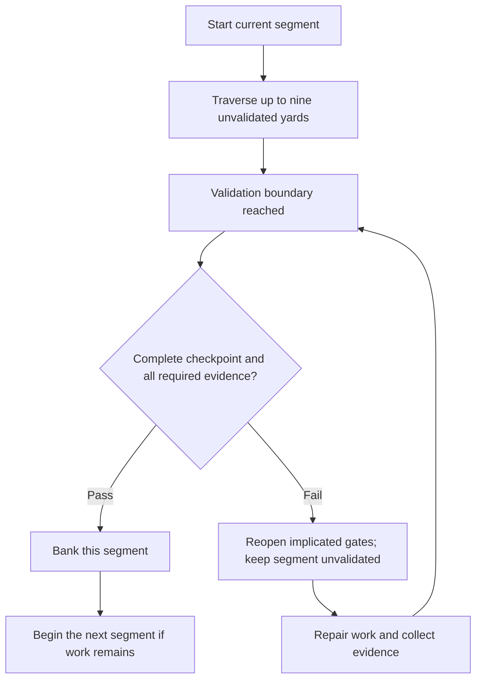

# Field geometry & special teams

`playbook-field` revises Yards-To-Goal from a scalar distance into
**evidence-backed field geometry** derived from the gate graph. The yard line
is no longer a number the drive asserts; it is a position on a constructed
field whose segments, boundaries, penalties and scoring plays are all
journalled and replay-deterministic (I-17).

## The Opposition Kicker constructs the field

Before the offence takes possession, the opposition's Kicker declares the
field: a 99-gate maximum productive envelope (`MAX_PRODUCTIVE_GATES`),
segmented at every tenth productive gate (`SEGMENT_YARDS = 10`). Each
segment end is a **validation boundary** — a named requirement over
evidence classes (`test`, `benchmark`, `human_input`, or an admitted
all-of combination). The field length is derived from the objective's gate
graph, never from prose or estimation. A 35-yard field carries boundaries
at 10, 20 and 30.

## The 9+1 validation rhythm

Nine unvalidated yards are traversable (`MAX_UNVALIDATED_YARDS = 9`); the
tenth ordinary productive yard is reserved for validation. The geometry
refuses a tenth yard with `ProgressRefusal::ValidationBoundaryReached` —
progress has stalled until the boundary passes. A failed boundary does not
bank: the implicated gates reopen and the segment's yards return to
unvalidated. Passing a boundary requires both a **complete consolidation
checkpoint** (all six questions answered) and presented evidence that
satisfies the boundary's all-of requirement (I-13). Only then does the
segment bank, and banked yards are never lost to a later failure.

## Visual play: bank progress at the boundary

Think of a segment as a short set of work with a review at its end. Nine
unvalidated yards allow work to proceed; validation controls whether the
segment becomes banked progress. The boxes show state transitions, not elapsed
time or a percentage estimate.

A later failure can reopen work in the current segment. It does not erase
previously banked yards. Neither the diagram nor the football metaphor lets
an unvalidated claim bypass the boundary.

## Red Zone: closure feasibility, not yardage

The semantic Red Zone is entered when every outstanding mandatory gate is
assessable as closable under the session's available capabilities, evidence
classes, human input and reachable dependencies — conservative by design:
if any outstanding mandatory gate cannot be assessed closable, the drive is
not in the Red Zone. It is independent of field-goal range (§25): a drive
can be in range with the Red Zone closed, and the two states journal and
exit independently.

## Penalties and provenance

Field adjustments carry **foreseeability provenance** (I-06/I-07):
`exogenous` (external environment), `discovery` (a real constraint found in
the codebase), `estimation_error` (the estimate was wrong), or
`execution_created` (we broke it). A **Harder** adjustment with exogenous
foreseeability is an ExternalEnvironmentAdjustment; with discovery or
estimation error it is an **OffensivePenalty** (the field extends);
execution-created regressions are execution regressions and earn execution
credit (I-09/I-10: provenance is never masqueraded). An **Easier** adjustment
is always a **DefensivePenalty** (the field contracts). Every adjustment is
journalled with its cause; the fold applies the yardage delta because the
journal is authoritative.

## Special teams: the Offensive Kicker

Field-goal range is **utility dominance, not yardage** (I-12): a drive is in
range when one admissible bounded terminal action satisfies
`U_kick > U_drive`. The kick runs under a `KickContract` with mandatory
ceilings — objective, permitted action, cost, latency, side-effect scope,
success evidence, rollback policy — and cannot expand scope or redefine
failure as partial success (I-15). A kick cannot establish success without
independent verification (I-14). Kicker candidates are scored by distinct
terminal priors (§22): completion probability ×4, evidence quality ×2, low
variance and low rollback risk over eight weights — the best progressive
agent is not automatically the best terminal-action agent. Outcomes are the
four-way set: **Score, CleanMiss, Blocked, Turnover** — harm dominates
classification, an external block is never a miss, and a scored kick
requires evidence.

## Routing from the field state

Playbook selects among four options — continue the drive, validate, attempt
the field goal, invoke Lastdown — by deterministic decision order (§32): a
failed validation reopens gates first; a pending boundary at nine
unvalidated yards forces validation; a dominant kick with a kicker available
beats continuation even in the Red Zone; Red Zone entry otherwise optimises
completion; Lastdown is invoked when the budget cannot survive another
segment.

## Shadow Defence: opportunity-cost opposition

Every significant personnel decision creates its own opposition
(`shadow.rs`). The Shadow Defence is the **best credible line-up Playbook
chose not to field**: the strongest Pareto-efficient alternative under the
drive's current utility weighting. Three constitutional rules hold:

* The counterfactual is **frozen at decision time** — only what was knowable
  then enters the snapshot; no hindsight leakage.
* The **Pareto frontier is preserved, never collapsed to one scalar best** —
  expensive-capable, balanced, and cheap-adequate shapes all remain
  efficient; the current utility weights choose among them.
* **Evidence tiers are explicit** (A equivalent-task history → E model
  self-assessment) — synthetic comparison never becomes fictitious empirical
  fact.

The opportunity-cost delta answers what raw progress cannot: the offence may
be moving forward while still losing the game economically. Prospective
opposition informs coaching; retrospective opposition evaluates the roster
after the drive; the two are never conflated.

## Tov normalisation

A validation-boundary presentation may be normalised through the tov
adapter (`tov/adapters/field-normalise.tov`) via
`playbook_sim::try_tov_field_normalise`: the checkpoint must be complete and
the presented classes must cover every required class. Rust remains the
authority when the adapter is missing or fails (I-11).

## Journal

All of it is on the record: field construction, segment starts, unvalidated
progress, boundary reached/passed/failed, banked progress, adjustments and
penalties, Red Zone and range transitions, kicker evaluation, kick
admission/attempt/outcome, and touchdowns — 24 event variants in
`playbook-events`, folded by `playbook-state` into `FieldGeometryState` on
`DriveState`. The campaign matrix lives in
`crates/playbook-state/tests/field_geometry.rs`.
