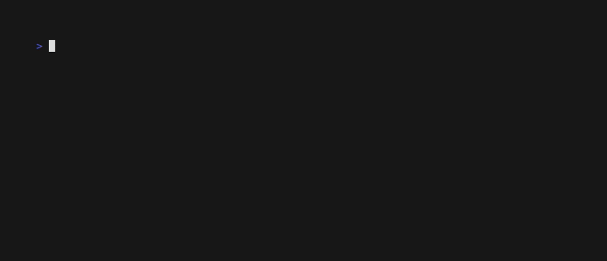

# Matchday: the presentation contract

Playbook Matchday is the operational command environment — **Football
Manager × broadcast telemetry, rendered through a terminal**. This document
argues its design in PEEVE: each section states the **Point**, shows the
**Evidence**, gives the **Explanation**, names the **Visualisation**, and
sets the **Evaluation** — how you would catch the claim failing.

The design rule is absolute, and every section below is a consequence of
it:

> The TUI is a projection of authoritative Playbook state. Football
> semantics are presentation metadata over machine state; nothing in the
> presentation layer interprets, it maps.

---

## Layering

**Point.** Visualisation is a downstream consumer of the authority, never
a second authority.

**Evidence.** `playbook-presentation` depends on `playbook-state` and
`playbook-events` only; `playbook-tui` depends on `playbook-presentation`.
No renderer names a business-logic type, and no projection mutates
anything.

```text
authoritative state (DriveState, folded from the journal)
     ↓
playbook-presentation   deterministic 3form semantic projection
     ↓
playbook-tui            first renderer (frames, CLI, film room)
```

**Explanation.** This extends the `playbook-cards` invariant — visualisation
is generated from the same data the authority executes, so doctrine and
diagrams cannot drift — and forbids the widget-calls-business-logic shape
that would couple a rendering choice to a rule change.

**Visualisation.** The crate graph above; the frames below are its proof.

**Evaluation.** `cargo tree -p playbook-tui` must never show
`playbook-tui → playbook-state` directly; the presentation crate is the
only edge. A new visual surface that needs a fact the snapshot lacks must
extend the snapshot, not reach around it — a change that does the latter
fails this evaluation.

---

## The 3form protocol

**Point.** Every important Playbook noun or event has exactly three forms
of the same truth: a **glance** (one line), a **tactical** block (the
spatial view), and **analytical** rows (forensic label/value pairs).

**Evidence.** `present_event(&DriveEvent) -> ThreeForm` produces all
three per event — `FIRST DOWN • +10 • boundary ✓` is a glance; the field
rail is a tactical form; `Gate  G17 / Evidence 4/4` rows are analytical.
The test `the_three_forms_project_the_same_event_without_disagreement`
pins one event projecting identically twice, and
`the_three_forms_project_each_event` covers every event of the campaign
fixture.

**Explanation.** The forms cannot disagree because they cannot interpret:
all three are pure functions of the same event, with no shared mutable
state and no independent judgment. A new event variant that wants a
presentation writes all three forms together, in one match arm.

**Visualisation.** The Film Room gif below is the protocol in motion —
the depth switch cycles glance → tactical → analytical on one frame.

**Evaluation.** A form left empty fails
`the_three_forms_project_each_event`; an event variant without a match
arm fails the build, because the projection is exhaustive.

---

## The snapshot

**Point.** One pure function turns a drive state into everything any
surface may show — and it shows nothing the authority cannot answer.

**Evidence.** `PresentationSnapshot::from_state(&DriveState)` projects:

* **ScoreBug** — drive id, down label, YTG in milli-yards, Δ yards this
  cycle, completion, spend, the broadcast clock (consumed wall time),
  status and disposition.
* **FieldProjection** — the semantic field from the gate graph: declared
  length (Opposition Kicker), banked vs unvalidated yards, every validation
  boundary with its state, Red Zone, field-goal range, kick outcome,
  touchdown.
* **Roster / PlayerRow** — the active player, assessed personnel and the
  bench, each with measured reliability and quota, never self-report.
* **Plays** — the admitted tactic history from the TacticsLedger.
* **GateRows** — the game-plan board: mandatory flags, gate states,
  satisfaction and confidence.
* **ShadowCompare** (optional, built by the caller from
  `playbook_field::shadow`) — the best credible line-up Playbook did not
  field, with the signed opportunity-cost delta and whether the starters
  sit on the Pareto frontier.
* **BlitzOverlay** — the live blitz: parallel runners, candidates, the
  verified winner, waves.
* **HuddleStrip** — active coordination topology.
* **SubstitutionRow** — the medical/board record.

The test `the_snapshot_is_a_pure_function_of_state` proves Audit and
Resimulate folds project identically (I-17).

**Explanation.** Purity plus `Eq` plus `Serialize` means the same journal
yields byte-identical snapshots for the terminal, a web dashboard, the
play cards and a replay recording. The football metaphors live only in
the field *labels* — the values underneath are the authority's own
milli-yards and ppm.

**Visualisation.** Manager Mode (below) is the snapshot rendered whole.

**Evaluation.** A snapshot field that no renderer reads gets deleted; a
renderer need with no snapshot field is a bug in the snapshot, never a
reason to touch `DriveState` from the TUI.

---

## The three principal experiences

**Point.** Three modes answer three different questions, and nothing else
needs a screen.

```text
MANAGER MODE  → control    (the dugout: formation, roster, play call)
BROADCAST     → observe    (scorebug, field rail, evidence, overlays)
FILM ROOM     → understand (frame-by-frame replay of any journal)
```

**Evidence.** Manager Mode renders the dugout from the snapshot alone —
formation pane, field rail, roster, play call, the key bar. Broadcast
Mode leads with the persistent scorebug and the field; the Red Zone
banner appears exactly when `field.red_zone` is true. The golden tests
pin the scorebug, dugout and broadcast frames against constructed
snapshots.

**Explanation.** The separation is cognitive, not cosmetic: control needs
expected economics and alternatives; observation needs the scorebug and
the field; understanding needs time and depth. Modes that mix these
produce dashboards where nothing is answerable.

**Visualisation.**

### Manager Mode — the dugout


### Broadcast Mode — what is happening right now


**Evaluation.** Every element on screen must trace to a snapshot field —
a rendered number without a field underneath fails review, and the golden
tests fail if a frame changes without a snapshot change to justify it.

---

## Film Room: the TUI is replayable

**Point.** Because the journal is deterministic, film review exists — and
it cannot disagree with what the authority actually did.

**Evidence.** `playbook-tui --replay journal.jsonl` steps frame-by-frame;
`--frame N` jumps; `--live` tails. The test
`the_film_room_replays_a_real_mvp_journal` folds a real MVP run and
asserts **every frame** equals its prefix-fold snapshot — all sixty-one.

**Explanation.** `frames(&events, &policy)` applies the same `apply` the
live authority uses, one event at a time, snapshotting after each. There
is no second engine to drift — a frame is the state, not a
reconstruction of it.

**Visualisation.**



Film-room keys: `ENTER`/`n` next frame, `p` back, `f` cycles the depth
switch (glance → tactical → forensic), `F` returns to the full-frame form,
`k` the kick decision moment, `d` the Lastdown decision moment, `r` roster
depth, `h` the heat map, `g` jump to the final whistle, `q` quit.

```text
playbook-tui --replay journal.jsonl                 # step through, film review
playbook-tui --replay journal.jsonl --frame 42      # one frame
playbook-tui --replay journal.jsonl --form broadcast
playbook-tui --live   journal.jsonl                 # follow a live journal
```

**Evaluation.** Frame *i* must equal `fold(events[..=i])` for all *i* —
the parity loop checks exactly this, and any replay feature that computes
state by any other means fails it by construction.

---

## The heat map shows style of work

**Point.** The possession heat map answers "what *kind* of work
happened", not "how many tokens were burned".

**Evidence.** Recent event kinds are placed on four action phases —
defensive, possession, progressive, clinical — deterministic by
vocabulary kind: blitz and tool failures sit defensive; huddles,
substitutions and punts sit possession; tactics, gates and evidence sit
progressive; kicks and touchdowns sit clinical.

**Explanation.** Token charts measure cost; phase placement measures the
*character* of the work. Both matter, but only one tells you whether the
drive was fighting, coordinating, advancing or finishing.

**Visualisation.** `h` in the Film Room renders the block; the four phase
columns are the contract.

**Evaluation.** The phase function is total (unknown kinds default to
progressive) and deterministic: a scenario run twice renders the same
block, and a drive of pure kicks lights only the clinical column.

---

## Design constraint

**Point.** No dense hacker-terminal aesthetics.

**Evidence.** Every frame in this document — dugout, broadcast, film
room, heat map — carries at most a handful of statistics per screen, one
colour accent per element.

**Explanation.** Playbook has too many concepts for green-number density:
large empty regions, strong typographic hierarchy, a small number of huge
statistics, persistent scorebug, restrained semantics. Think broadcast
graphics department, not btop with football words.

**Evaluation.** If a new panel needs a legend to explain its own legend,
it is over the line.

---

## Tests and recordings

The projection campaign lives in
`crates/playbook-presentation/tests/projection.rs` (snapshot purity, field
geometry, film parity, three-form coverage) and the Matchday campaign in
`crates/playbook-tui/tests/frames.rs` (golden scorebug, dugout, broadcast,
overlays, Shadow Defence on the dugout, and a full film-room replay of a
real MVP journal with per-frame parity). The recordings above are
regenerated from `docs/tapes/` with vhs against the installed binaries;
`docs/command-surface.md` applies the same PEEVE discipline to the CLI.
